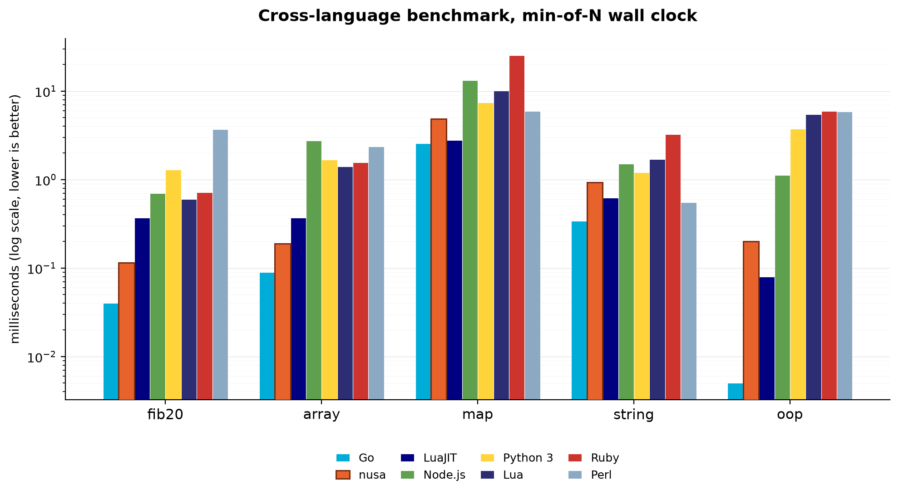

<p align="center">
  
</p>

# Nusantara

Nusantara is a programming language that compiles and runs itself — the lexer, parser, interpreter, bytecode VM, and native x86-64 and ARM64 compiler are all written in Nusantara, bootstrapped once by a small C++ host. You can write keywords in English (`func`, `if`, `return`) or Indonesian (`fungsi`, `jika`, `hasil`) and mix them freely in the same file; blocks can use colons or braces.

```python
func fib(n):
    if n < 2:
        return n
    return fib(n - 1) + fib(n - 2)

for i in range(10):
    print(fib(i))
```

## Running a program

```bash
./nusa main.ns              # compile to a cached native binary and run it
./nusa build main.ns -o app # compile straight to a native ELF binary
./app                       # no runtime, no dependencies
```

`nusa main.ns` works like `go run`: the first run compiles, later runs start from the cache until the source or one of its imports changes. The compiler turns `.ns` source into x86-64 or ARM64 machine code — tagged integers, fixed-offset structs for classes, inline caches for field and method lookups — with its own assembler and ELF writer, so no `as`, `ld`, or C compiler is needed, on Linux or in Termux on Android. Programs that use something the compiler does not support yet run in the interpreter instead; `NUSA_INTERP=1` or `--vm` selects the interpreter or bytecode VM explicitly.

## Benchmarks

Five workloads — `fib(20)`, a 20k-element array build, a 10k-entry map insert+lookup, a 5k-iteration string build, and a 10k object create+method call loop — run in every language below, min-of-N wall-clock milliseconds, log scale:



| Language | fib20 | array | map | string | oop |
|---|---:|---:|---:|---:|---:|
| Go 1.27 | 0.04 | 0.09 | 2.56 | 0.34 | <0.01 |
| **nusa** | **0.12** | **0.19** | **4.84** | **0.93** | **0.20** |
| LuaJIT 2.1 | 0.37 | 0.37 | 2.78 | 0.62 | 0.08 |
| Node.js 24 | 0.70 | 2.75 | 13.29 | 1.51 | 1.12 |
| Lua 5.5 | 0.60 | 1.41 | 10.13 | 1.69 | 5.44 |
| Ruby 3.4 | 0.72 | 1.56 | 25.49 | 3.24 | 5.96 |
| Python 3.14 | 1.30 | 1.68 | 7.44 | 1.20 | 3.73 |
| Perl 5.42 | 3.72 | 2.37 | 5.94 | 0.55 | 5.86 |

Measured on an Intel Core i5-7300U, Linux x86-64, runs interleaved. nusa is 2–3x off Go on `fib20`, `array`, `map`, and `string`, and faster than Node.js, Lua, Ruby, and Python on all five. LuaJIT is ahead on `map`, `string`, and `oop`, and Perl on `string`.

## Install

```bash
make build    # bootstrap core/main.ns into ./nusa
make test     # run every program in examples/, natively and in the interpreter
make install  # copy the binary to ~/.local/bin
```

## The language

| Indonesian | English | | Indonesian | English |
|---|---|---|---|---|
| `buat` | `let` / `var` | | `kelas` | `class` |
| `fungsi` | `func` | | `turunan` | `extends` |
| `jika` / `lain` / `kalau` | `if` / `else` / `elif` | | `dalam` | `in` |
| `selama` | `while` | | `coba` / `tangkap` | `try` / `except` |
| `untuk` | `for` | | `lempar` | `throw` |
| `hasil` | `return` | | `benar` / `salah` | `true` / `false` |
| `berhenti` / `lanjut` | `break` / `continue` | | `kosong` | `null` / `None` |
| `dan` / `atau` / `bukan` | `and` / `or` / `not` | | | |

Classes support default parameter values, inheritance, and three interchangeable names for the instance reference (`self`, `this`, `ini`):

```python
class Animal:
    func __init__(self, name, sound = "a sound"):
        self.name = name
        self.sound = sound
    func speak(self):
        print(self.name, "makes", self.sound)

class Dog(Animal):
    func __init__(self, name):
        self.name = name
        self.sound = "a bark"

Dog("Rex").speak()  # Rex makes a bark
```

## Standard library highlights

`runCommand(cmd, args)` spawns a process straight through `fork`/`execve`/`pipe`/`waitpid` in the native backend, with no shell in between — argument lists can't be reinterpreted as shell syntax. File access is `readFile`, `writeFile`, and `fileExists`. `impor()` pulls in another `.ns` file, and the native compiler resolves and inlines it statically at compile time. `gcInfo()` and `gcForce()` let you inspect and trigger the garbage collector directly.

## Repository layout

```
core/        lexer, parser, AST, interpreter, bytecode VM, CLI entry point
compiler/    native x86-64 and ARM64 compiler, runtime, and built-in assembler
std/         standard library (process, filesystem, i18n, ...)
net/         HTTP and socket modules
crypto/      hashing and crypto modules
media/       audio/image processing modules
lib/         additional pure-.ns utility modules
examples/    small programs showing the language, one feature each
```

## License

Apache-2.0 — see [LICENSE](LICENSE) and [NOTICE](NOTICE).
