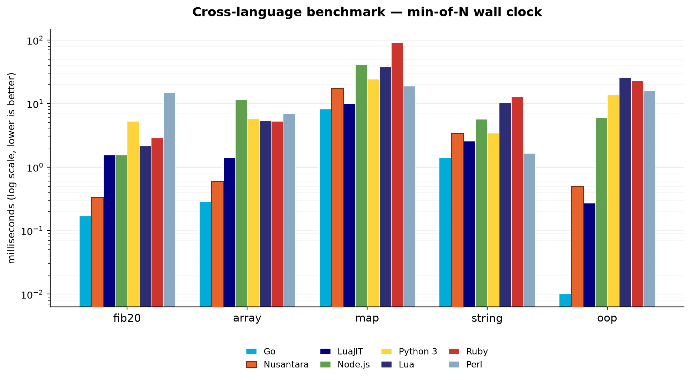

# Nusantara

A self-hosted programming language: the lexer, parser, interpreter, bytecode VM, and native x86-64 AOT compiler are all written in Nusantara (`.ns`) itself, bootstrapped once by a small C++ host. Keywords come in English (`func`, `if`, `return`) and Indonesian (`fungsi`, `jika`, `hasil`) flavors that can be mixed freely, with both colon-indented and brace blocks.

```python
func fib(n):
    if n < 2:
        return n
    return fib(n - 1) + fib(n - 2)

for i in range(10):
    print(fib(i))
```

## Three ways to run a program

```bash
./nusa run main.ns                    # tree-walking interpreter (reference implementation)
./nusa --vm main.ns                   # stack-based bytecode VM
./nusa build --native main.ns -o app  # compile straight to a native ELF binary
./app                                 # no runtime, no dependencies
```

The native AOT compiler is the one that matters for speed: it turns `.ns` source into x86-64 assembly by hand (tagged 63-bit integers, fixed-offset struct layout for classes, inline caches for field and method access) and assembles it with the system `as`/`ld`. The interpreter and VM exist as slower, simpler references for checking that the language behaves the same way everywhere.

## Benchmarks

Five workloads — `fib(20)`, a 20k-element array build, a 10k-entry map insert+lookup, a 5k-iteration string build, and a 10k object create+method call loop — run in every language below, min-of-N wall-clock milliseconds, log scale:



Native AOT lands within ~2x of Go on `fib20`, `array`, and `oop`, and ahead of every other language here except LuaJIT on `oop`. `map` and `string` are the current weak points.

## Install

```bash
make build    # bootstrap core/main.ns into ./nusa
make test     # run the interpreter, VM, and native AOT test suites
make install  # copy the binary to ~/.local/bin
```

## The language

| Indonesian | English | | Indonesian | English |
|---|---|---|---|---|
| `buat` | `let` / `var` | | `kelas` | `class` |
| `fungsi` | `func` | | `turunan` | `extends` |
| `jika` / `lain` / `kalau` | `if` / `else` / `elif` | | `dalam` | `in` |
| `selama` | `while` | | `coba` / `tangkap` | `try` / `except` |
| `untuk` | `for` | | `lempar` | `throw` |
| `hasil` | `return` | | `benar` / `salah` | `true` / `false` |
| `berhenti` / `lanjut` | `break` / `continue` | | `kosong` | `null` / `None` |
| `dan` / `atau` / `bukan` | `and` / `or` / `not` | | | |

Classes support default parameter values, inheritance, and three interchangeable names for the instance reference (`self`, `this`, `ini`):

```python
class Animal:
    func __init__(self, name, sound = "a sound"):
        self.name = name
        self.sound = sound
    func speak(self):
        print(self.name, "makes", self.sound)

class Dog(Animal):
    func __init__(self, name):
        self.name = name
        self.sound = "a bark"

Dog("Rex").speak()  # Rex makes a bark
```

## Standard library highlights

- `runCommand(cmd, args)`: spawns a process directly via `fork`/`execve`/`pipe`/`waitpid` in the native backend — no shell is invoked, so argument lists can't be reinterpreted as shell syntax.
- `readFile`, `writeFile`, `fileExists`.
- `impor()`: imports another `.ns` file; the native compiler resolves and inlines it statically at compile time.
- `gcInfo()` / `gcForce()`: inspect and trigger the garbage collector.

## Repository layout

```
core/        lexer, parser, AST, interpreter, bytecode VM, CLI entry point
compiler/    native x86-64 AOT compiler and its hand-written runtime
std/         standard library (process, filesystem, i18n, ...)
net/         HTTP and socket modules
crypto/      hashing and crypto modules
media/       audio/image processing modules
lib/         additional pure-.ns utility modules
bench/       cross-language benchmark suite and native micro-benchmark
tests/       interpreter/VM/native test suites
```

## License

Apache-2.0 — see [LICENSE](LICENSE) and [NOTICE](NOTICE).
